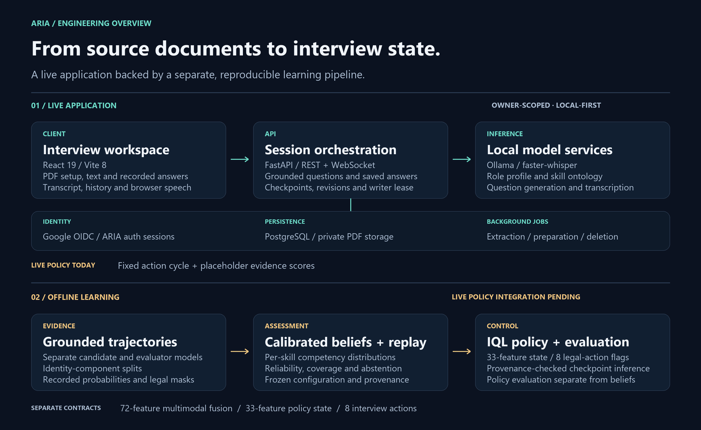
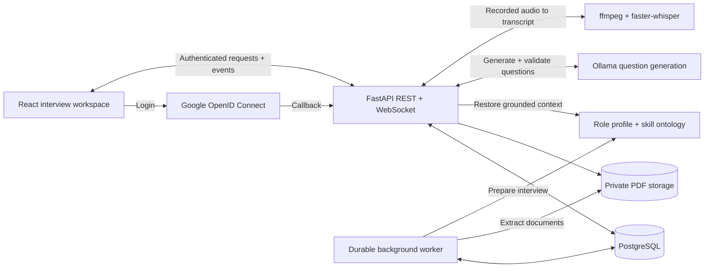
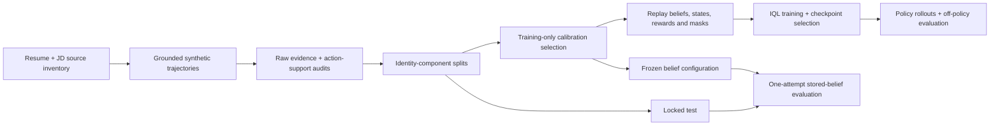

<div align="center">

# ARIA: Autonomous Reinforcement-Based Interview Agent

### Local-first technical interview practice with grounded questions and probabilistic assessment.

**Turn a résumé and job description into a role-specific interview.**

[](#quick-start)
[](#architecture)
[](frontend/)
[](backend/models.py)
[](#beliefs-and-policy)

[Quick start](#quick-start) · [Architecture](#architecture) · [Engineering details](#engineering-details) · [Evaluation](#evaluation) · [Development](#development) · [Documentation](#documentation)

<code>.\run.ps1</code>

<br /><br />

<a href="docs/assets/aria-overview.svg"></a>

<br />

</div>

ARIA helps students and job seekers practice technical interviews against a specific role. Upload a résumé and job description, answer by text or recorded audio, and return to your saved interview history. Local language models construct a grounded skill profile and generate questions tied to the source documents.

The research architecture treats interviewing as sequential inference: maintain uncertainty over each skill, gather answer evidence, and choose the next action with an offline reinforcement-learning policy. Fifteen modules cover perception, beliefs, policy learning, question generation, and feedback.

> **Current status:** the authenticated application, document processing, persisted interviews, streaming questions, and audio transcription are implemented. The live loop still uses placeholder evidence scores and a fixed three-action cycle. Calibrated beliefs and the trained IQL policy work in the offline pipeline; connecting them to the live interview, along with full multimodal analysis and final reporting, is the next integration milestone. ARIA is an interview-practice research prototype, not an automated hiring system.

## Quick start

### Prerequisites

The commands below target **Windows PowerShell**, the project's development environment.

| Dependency | Used for |
| --- | --- |
| Python **3.11** | Backend, perception modules, and offline learning |
| Node.js **22.12+** and npm | React 19 / Vite 8 frontend |
| Docker Desktop with Compose | Local PostgreSQL 17 database |
| Ollama | Local ontology and question generation |
| `ffmpeg` on `PATH` | Decoding recorded audio for transcription |
| Google OAuth web client | OpenID Connect login |

Development targets an RTX 4060 laptop with 8 GB VRAM. Selected modules support CPU execution through `ARIA_DEVICE=cpu`; latency and simultaneous model residency depend on the enabled stack. Speech and perception components may download model weights on first use.

### Install and configure

For a fresh checkout:

```powershell
git clone https://github.com/KV225511/ARIA.git
Set-Location ARIA

py -3.11 -m venv .venv
.\.venv\Scripts\Activate.ps1
python -m pip install -r requirements.txt

Copy-Item .env.example .env
python scripts/generate_dev_keys.py

Set-Location frontend
npm ci
Set-Location ..

ollama pull qwen2.5:7b
```

The key generator creates local JWT signing keys and prints an `ARIA_OAUTH_ENCRYPTION_KEY`. Copy that value into `.env`, supply your Google client credentials, and add the Ollama settings:

```dotenv
ARIA_GOOGLE_CLIENT_ID=your-google-web-client-id
ARIA_GOOGLE_CLIENT_SECRET=your-google-web-client-secret
ARIA_OAUTH_ENCRYPTION_KEY=the-value-printed-by-generate_dev_keys
OLLAMA_HOST=http://localhost:11434
OLLAMA_MODEL=qwen2.5:7b
```

Set the Google client's authorized redirect URI to `http://localhost:8000/api/auth/google/callback`. Use `http://localhost:5173` as the frontend origin. Setting `OLLAMA_MODEL` explicitly gives ontology and question generation the same installed model. Keep Ollama running before starting an interview.

### Run the application

```powershell
.\run.ps1
```

The launcher starts PostgreSQL, applies migrations, starts the API and durable worker, then runs Vite. It clears an existing process on port `8000` before starting the backend.

| Service | Address |
| --- | --- |
| Application | [localhost:5173](http://localhost:5173) |
| Interactive API docs | [localhost:8000/docs](http://localhost:8000/docs) |
| API and database health | [localhost:8000/api/health](http://localhost:8000/api/health) |

Sign in with Google, accept the privacy consent, upload two text-extractable PDFs, and wait for processing to finish. Start an interview, submit typed or recorded answers, then resume it from history or explicitly complete or cancel it. PDF uploads are limited to **10 MB and 50 pages each**.

<details>
<summary><strong>Run the services separately</strong></summary>

From the repository root, activate the virtual environment and start the database. Wait until `docker compose ps` reports PostgreSQL as healthy before applying migrations.

```powershell
.\.venv\Scripts\Activate.ps1
docker compose up -d postgres
docker compose ps
python -m alembic upgrade head
```

Then use three terminals:

```powershell
# Terminal 1 — repository root
.\.venv\Scripts\python.exe -m backend.server --port 8000

# Terminal 2 — repository root
.\.venv\Scripts\python.exe -m backend.worker

# Terminal 3 — repository root
Set-Location frontend
npm run dev
```

The `backend.server` entry point selects a Windows-compatible event loop for Psycopg's asynchronous connections. Vite proxies `/api` and `/ws` to the backend.

</details>

<details>
<summary><strong>Configuration reference</strong></summary>

| Setting | Default or location | Purpose |
| --- | --- | --- |
| `ARIA_DATABASE_URL` | PostgreSQL at `127.0.0.1:55432/aria` | Async application database |
| `ARIA_MIGRATION_DATABASE_URL` | Same local database | Alembic migrations |
| `ARIA_PUBLIC_ORIGIN` | `http://localhost:5173` | Permitted frontend origin |
| `ARIA_API_ORIGIN` | `http://localhost:8000` | API origin |
| `ARIA_GOOGLE_REDIRECT_URI` | `http://localhost:8000/api/auth/google/callback` | OAuth callback |
| `ARIA_JWT_PRIVATE_KEY_PATH` / `ARIA_JWT_PUBLIC_KEY_PATH` | `.aria-private/` | Access-token signing keys |
| `ARIA_STORAGE_ROOT` | `data/private_documents` | Private uploaded PDFs |
| `ARIA_DEVICE` | `cuda` | ML device selection |
| `OLLAMA_HOST` | `http://localhost:11434` | Local model service |
| `OLLAMA_MODEL` | Set explicitly during setup | Live ontology and question model |
| `ARIA_CANDIDATE_MODEL` / `ARIA_EVALUATOR_MODEL` | `qwen2.5:7b` / `gemma3:4b` | Distinct models for offline synthetic evidence |

See [`.env.example`](.env.example), [backend settings](backend/settings.py), and [model settings](config/settings.py). JWT keys, credentials, and private candidate files belong in their existing ignored locations.

</details>

## Architecture

The application and offline learning pipeline have distinct execution paths. **`backend.api` is the served application**, re-exported by `app.py`. PostgreSQL owns account and interview history; Module 15's standalone SQLite logger serves a separate research workflow.



The frontend owns uploads, recording, transcript display, connection state, and history navigation. The backend owns accepted answers, final questions, session revisions, checkpoints, and lifecycle transitions. Generated text can stream before validation; only an accepted question becomes authoritative history.

### Module map

| Area | Modules | Implementation and integration |
| --- | --- | --- |
| Perception | **01** speech and semantic grading · **02** vision · **03** prosody | Speech transcription is live. Semantic grading, facial/gaze features, acoustic features, and personal baselines have separate implementations. |
| Fusion | **04** multimodal fusion | Fixed 72-feature schema, normalization, modality availability, attention gating, and concatenation baseline; pending live integration. |
| Assessment | **05** skill ontology · **06** competency beliefs | Grounded ontology is live. The calibrated assessment path runs offline; live evidence remains a placeholder. |
| Interview control | **07** offline RL · **08** question generation | Custom IQL training and validated inference exist offline. Grounded Ollama question generation is live. |
| Speech delivery | **09** TTS/avatar | Browser speech synthesis is live. Server TTS is a separate prototype; avatar output remains a placeholder. |
| Context and auditing | **10** cognitive load · **11** integrity signals · **12** incongruence · **13** fairness | Independent analysis modules; full live orchestration and validation remain open. |
| Reports and feedback | **14** evaluation · **15** feedback | Structured reports, evaluation tooling, and SQLite trajectory logging; final user-facing reporting is pending. |

Explore the [complete module diagram](docs/architecture/README.md) and its editable Excalidraw source. Older design documents preserve historical implementations; the contracts described here reflect the current code.

## Engineering details

### Durable interviews and recoverable operations

- **Owned data at the database boundary.** Composite foreign keys bind interview inputs to both the account and document kind. A résumé belonging to another account cannot be attached as an interview input. See [database models](backend/models.py).
- **Idempotent submissions.** Document and interview creation use request IDs. Answers bind a client submission ID to a request fingerprint, so a repeated accepted submission can return its original result while conflicting reuse is rejected. See [interview operations](backend/interviews.py).
- **Versioned runtime checkpoints.** Accepted questions and answers advance the interview revision and persist reconstructable ontology/belief state. A question generated against a stale revision is rejected before commit.
- **One active writer.** An authenticated WebSocket holds a PostgreSQL lease identified by a connection ID and epoch. Heartbeats renew the lease; other tabs can read and explicitly request control. Completion and cancellation invalidate active control.
- **Durable background work.** Document processing, session preparation, and deletion use persisted jobs. Workers claim queued work with PostgreSQL row locks and `SKIP LOCKED`. Question generation records its own jobs and validation attempts. See [worker](backend/worker.py) and [API](backend/api.py).

Google OIDC uses state, nonce, and PKCE. ARIA then issues RS256 access tokens and rotating refresh tokens in HttpOnly cookies, with origin and CSRF checks on browser writes. Uploaded PDFs use private filesystem storage; recorded audio is transient and only its transcript is retained.

### Grounded question generation

The [ontology and grounding layer](modules/module_05_ontology/grounding.py) connects skills to evidence spans in the job description and records résumé overlap. Question generation receives a selected action, target skill, source context, and conversation history. Outputs are normalized and checked before acceptance; rejected attempts receive corrective context and remain outside the final question history.

This establishes a testable boundary: interview strategy selects **what to ask**, while the language model expresses **how to ask it**. The current live strategy cycles through fixed actions; the trained policy will replace that selector when integration is complete.

<a id="beliefs-and-policy"></a>

### Calibrated beliefs and the eight-action policy

Each skill has a probability distribution over **Beginner, Mid, and Expert**. The [belief updater](modules/module_06_belief/belief_state.py) applies semantic-score likelihoods in log space, weights updates by evidence reliability, discounts repeated evidence, and caps effective sample size. Aggregation uses visited skills, with explicit coverage and abstention conditions. Behavioral inputs do not directly alter the technical-competency likelihood.

The representations have separate contracts:

| Representation | Shape | Meaning |
| --- | --- | --- |
| Multimodal fusion | **72 features** | 11 text, 33 vision, and 28 prosody features |
| Policy state | **33 features**, `aria-state-v4` | Global and focused beliefs, entropy, coverage, turn/evidence progress, previous evidence/context, previous action, and availability flags |
| Valid-action mask | **8 entries**, separate from state | Which interview actions are legal at this step |

The eight actions are `increase_difficulty`, `decrease_difficulty`, `ask_follow_up_same_topic`, `switch_topic`, `probe_foundation`, `ask_behavioral`, `ask_situational`, and `conclude_interview`.

[Custom PyTorch IQL](modules/module_07_rl/train.py) uses a value network, twin Q networks, and an eight-action policy network, each with two 256-unit hidden layers. Training combines expectile value regression, Q learning, and advantage-weighted policy learning. The [inference runtime](modules/module_07_rl/iql_policy.py) normalizes probabilities over legal actions and rejects malformed states or masks with no legal action.

Loading a validated checkpoint requires the matching **calibration protocol, protocol state, development bundle, split manifest, and belief configuration**. The loader checks their provenance hashes, the ordered state features, checkpoint schema, embedded configuration, and network compatibility before inference.

### Reproducible offline learning



Résumés and job descriptions are grouped by connected identity components to prevent source overlap across splits. Replay derives states and rewards from recorded evidence under a frozen belief configuration. Logged action probabilities, masks, and schema versions make those transitions auditable.

The v7 calibration protocol restricts selection to the original training components because its parent validation set has already been observed. Its locked test is reserved for the final release evaluation. Policy comparison tooling separately includes scripted baselines, behavior cloning, CQL, a Decision Transformer adaptation, and off-policy estimators.

Existing datasets and trained checkpoints are preserved. Running the application does not retrain the policy. See the [experiment runbook](docs/runbooks/benchmarks/SOTA_TRAINING_RUNBOOK.md) and [v7 protocol implementation](modules/module_07_rl/calibration_protocol_v7.py) for the research workflow.

## Evaluation

The saved **v7 locked synthetic evaluation** measures terminal competency classification by the belief model across **91 episodes from 6 identity components**.

| Metric | Recorded value |
| --- | ---: |
| Accuracy | **91.21%** |
| Macro F1 | **0.9168** |
| Balanced accuracy | **92.27%** |
| Expected calibration error | **0.0870** |
| Brier score | **0.1395** |
| Classification coverage | **100%** |

Source: [saved evaluation artifact](data/synthetic/v3/production-grounding-v10/derived-calibration-v7/release/locked_test_evaluation_v1.json). The report explicitly records `evaluates_learned_policy: false`. These are stored-belief results on synthetic episodes; they do not establish learned-policy benefit, human-interview performance, or fairness. See [reproducibility details](paper/reproducibility_statement.md) and [evaluation limitations](paper/limitations_and_nonclaims.md).

## Development

### Checks

From the repository root with the virtual environment active:

```powershell
python -m pytest -q
```

For a focused check of authentication/persistence contracts, grounding, and policy inference:

```powershell
python -m pytest -q tests/test_auth_persistence_contracts.py tests/test_grounding.py tests/test_iql_policy.py
```

Frontend checks:

```powershell
Set-Location frontend
npm run lint
npm run build
```

Test files cover belief calibration, replay provenance, split isolation, action masks, grounded generation, document validation, and persistence contracts. GPU/openSMILE tests require their model dependencies. The PostgreSQL integration test is opt-in through `ARIA_RUN_POSTGRES_TESTS=1` and requires a migrated test database. Some legacy in-memory transport tests are explicitly skipped after the move to authenticated PostgreSQL sessions; a default test run is not a complete live-session acceptance test.

### Repository map

```text
ARIA/
├── app.py                 # Re-exports the served backend.api application
├── backend/               # Auth, REST/WebSocket, storage, jobs, session state
├── frontend/              # React/Vite interview UI and API client
├── modules/               # Fifteen perception, assessment, and research modules
├── config/                # Model settings and comparator registry
├── migrations/            # Alembic database migrations
├── scripts/               # Setup utilities, including local key generation
├── tests/                 # Contract, module, integration, and benchmark tests
├── tools/                 # Calibration and evaluation entry points
├── data/                  # Source data and versioned research artifacts
├── paper/                 # Manuscripts, figures, and reproducibility records
├── docs/                  # Architecture, specifications, runbooks, and reports
├── compose.yaml           # Local PostgreSQL service
└── run.ps1                # Windows development launcher
```

### Next integration milestones

1. Connect measured semantic evidence and the saved calibrated belief configuration to live answers.
2. Load the matching frozen IQL checkpoint and enforce the 33-feature state and action-mask contracts in live interviews.
3. Complete multimodal availability handling, auxiliary analysis, and evidence-backed final reports.
4. Verify full-session recovery, concurrent-session isolation, cancellation, cleanup, latency, and candidate experience.

## FAQ

<details>
<summary><strong>Does the web application already use the learned policy?</strong></summary>

No. The offline training and inference path exists, but the live backend currently uses a fixed action cycle and placeholder evidence. The current interface is useful for exercising grounded conversation and session persistence; its belief displays are not validated assessments of an answer's quality.

</details>

<details>
<summary><strong>Does candidate content leave the machine?</strong></summary>

With the documented local configuration, PDF processing, transcription, and Ollama inference run locally. Google handles sign-in. PDFs and interview text persist in local private storage and PostgreSQL; recorded audio is transient. Changing a model-service endpoint changes where its inputs are processed.

</details>

<details>
<summary><strong>What if uploads stay queued or questions fail?</strong></summary>

Confirm PostgreSQL is healthy and `python -m backend.worker` is running for document and session preparation. For question generation, check Ollama is running, the model named by `OLLAMA_MODEL` is installed, and the PDFs contain extractable text. Accepted answers are persisted before the next question is generated, so generation failures can be retried without replacing the saved answer.

</details>

## Documentation

Start with the [categorized documentation index](docs/README.md).

- [Authentication and interview persistence specification](docs/specs/001-auth-and-interview-persistence.md): approved contracts, lifecycle, storage, and acceptance criteria.
- [Complete architecture diagram](docs/architecture/README.md): all fifteen modules, execution boundaries, and editable sources.
- [Software engineering study guide](docs/interview-prep/ARIA-software-engineering-study-guide.md): a technical walkthrough of the repository.
- [Experiment runbook](docs/runbooks/benchmarks/SOTA_TRAINING_RUNBOOK.md): evidence preflight, local baselines, and policy comparisons.
- [Research reproducibility record](paper/reproducibility_statement.md): saved artifacts, configuration, and result provenance.

---

<div align="center">
<sub>ARIA · Technical interview practice · Grounded generation, durable sessions, and offline policy research</sub>
</div>
